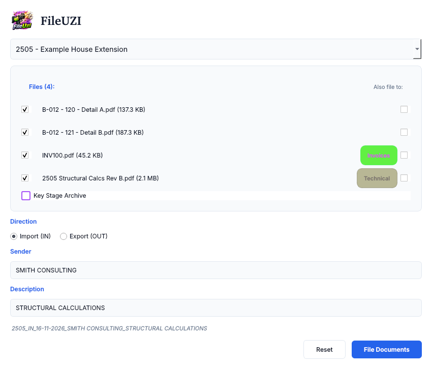

<p align="center">
  
</p>

<h1 align="center">FileUzi</h1>

<p align="center">
  Document filing for architectural practices — drag, detect, file.<br>
  Three tools that work together: a <b>drag-and-drop widget</b>, a <b>right-click renamer</b>, and an <b>AI-powered email panel</b>.
</p>

---

## What It Does

FileUzi takes the pain out of filing project emails, attachments, and drawings. Drop a file or email, and it figures out the job number, the direction, the contact, the category, and where it should go. You confirm and click File.



---

## The Three Tools

### 1. Filing Widget (`filing_widget.py`)

The main PyQt6 drag-and-drop interface. Handles emails, attachments, drawings, and regular files.

- Drag `.eml` files or folders onto the widget
- Auto-detects job number from filenames, email subjects, and custom project mappings
- Matches attachments against filing rules (Planning, Ecology, Fire Engineer, Surveys, Invoices, etc.)
- Files to dated import/export folders with secondary filing to category folders
- Detects drawings and supersedes older revisions automatically

### 2. Right-Click Renamer (`workflows/fileuzi_rename.py`)

A GNOME Files (Nautilus) script. Right-click a folder and rename it to the standard format:

```
2505_IN_15-11-2026_SMITH_STRUCTURAL CALCULATIONS
```

- Symlink into `~/.local/share/nautilus/scripts` as "File IN", "File OUT", "Also File To", "File Emails"
- Description pre-filled from files inside: keyword rules first, then AI if available
- Date from folder creation; prompts if files inside are dated differently
- "Also File To" offers secondary filing using the same `filing_rules.csv`

<!-- Add your own screenshots: assets/screenshots/rename-context-menu.png, rename-dialog.png -->

### 3. Email Panel (`workflows/fileuzi_panel.py`)

A floating always-on-top window launched by the renamer when `.eml` files are selected. Processes emails in the background, one ahead of the one on screen.

- Shows email metadata, body preview, and attachments
- AI-generated description (if LLM available)
- Tick/untick attachments, edit the title block, press File
- Filing happens in background while you review the next email

<!-- Add your own screenshot: assets/screenshots/panel-filing.png -->

---

## AI Integration

FileUzi uses local AI models for description writing and document classification. All inference runs **offline** with **no telemetry** — network access is blocked at the OS level.

### Language Model (Description Writer)

The renamer and email panel use a small language model to write one-line folder descriptions from email content:

```
Email: "Hi Jake, please find attached the structural engineer's calculations for the rear extension."
  →  STRUCTURAL CALCULATIONS FOR REAR EXTENSION
```

- **Model**: LFM2.5-1.2B-Instruct (1.2 billion parameters, ~700MB GGUF)
- **Runtime**: llama.cpp (`llama-server`) with OpenAI-compatible API
- **Learning**: Uses your 8 most recent filings as worked examples — it learns your style
- **Fallback**: If no model installed, falls back to keyword rules, then to manual entry

### Embedding Model (Keyword Matching)

For files that don't match any keyword rule, a tiny embedding model finds the closest category:

- **Model**: Bekko (ONNX, ~30MB) — semantic similarity between filenames and filing categories
- **Runtime**: ONNX Runtime (CPU only, 1 thread)
- **Install**: `pip install onnxruntime tokenizers` then `python3 fileuzi_rename.py --download-model`

### Vision Model (PDF Classification)

When a PDF doesn't match by name or keywords, page 1 is rendered and classified by image:

- **Model**: Mirage — a vision classifier for document types
- **Use case**: Distinguishes drawings from reports, letters from certificates

### Model Ability Test (`workflows/model_ability_test.py`)

Scores any GGUF model against your real filings and 12 built-in test emails:

```bash
python3 workflows/model_ability_test.py --models ~/models/*.gguf --n 30
```

Generates an HTML report comparing models by accuracy and speed.

<!-- Add your own screenshot: assets/screenshots/model-test-report.png -->

---

## Bubblewrap Sandbox

All AI models run inside a **bubblewrap** (`bwrap`) sandbox with:

- **No network** — empty network namespace, no internet access
- **Read-only filesystem** — only system files, Python packages, the script, and the model folder
- **No home directory** — no access to your projects, documents, or personal files
- **No writes** — except to a tmpfs and the LLM cache folder
- **Process isolation** — `--unshare-all`, `--die-with-parent`, `--new-session`

```
bwrap --unshare-all --die-with-parent --new-session \
      --ro-bind /usr /usr --ro-bind /etc /etc \
      --proc /proc --dev /dev --tmpfs /tmp \
      --ro-bind ~/models ~/models \
      llama-server -m model.gguf ...
```

If bubblewrap isn't installed, the LLM is **not used** (it refuses to run unsandboxed). A warning is shown:

> WARNING: The AI model is NOT running inside bubblewrap.
> Check: `which bwrap` (install: `sudo dnf install bubblewrap`)

PDF rendering (WeasyPrint) also runs inside bubblewrap when generating email PDFs, with external resource fetching disabled.

---

## Filing Rules

Filing rules are configured in `filing_rules.csv` (in the `*FILING-WIDGET-TOOLS*` folder):

| Keywords | Folder Type | Colour | Folder Location |
|----------|------------|--------|-----------------|
| Planning, CIL, DAS, Heritage... | Planning | `#3b82f6` | `/XXXX_ADMIN/XXXX_P_PLANNING` |
| Ecology, Bat, BNG, Wildlife... | Ecology | `#10b981` | `/XXXX_ADMIN/XXXX_E_ECOLOGY` |
| Fire, Part B, Sprinkler... | Fire Engineer | `#ef4444` | `/XXXX_ADMIN/XXXX_F_FIRE_ENGINEERING` |
| Survey, Topo, OS, Drone... | Surveys | `#8b5cf6` | `/XXXX_SURVEYS` |
| Invoice (+ INV###.pdf pattern) | Invoices | `#d946ef` | `/XXXX_ADMIN/XXXX_A_CLIENT/XXXX_INVOICES` |

Keywords trigger with word-boundary matching (so "OS" won't match inside "propOSed"). Multi-word phrases and fuzzy matching are supported. See `sample_filing_rules.csv` for the full template.

### Custom Project Mapping

Map client references to your internal job numbers in `custom_project_number_mapping.csv`:

```csv
Custom Project No:,Local Project No:
B-012,2505
B-013,2507
```

Files named `B-012 - 120 - Detail A.pdf` are automatically recognised as drawings for job 2505.

---

## Drawing Management

FileUzi recognises drawing files by naming convention:

| Format | Example |
|--------|---------|
| New (underscore) | `2506_22_PROPOSED FLOOR PLANS_C01.pdf` |
| Old (dash) | `2502 - 104 - BUILDING REGULATIONS NOTES_P01.pdf` |
| Custom prefix | `B-012 - 120 - Detail A.pdf` |

When a new revision is filed to Current Drawings:
1. The new file is copied in
2. Any older revision of the same drawing is moved to `Superseded/`
3. Only the latest revision remains in Current Drawings

<!-- Add your own screenshot: assets/screenshots/drawing-supersede.png -->

---

## Security

### Path Safety
- **Path jail** — every file operation validates the destination is within `projects_root`
- **Filename sanitisation** — email attachment names are stripped of directory components, control characters, and `.`/`..`
- **Circuit breaker** — caps file operations per action to prevent runaway bulk operations
- **Exclusive create** — the renamer uses `open(target, "xb")` to never overwrite existing files

### Input Safety
- **SQL** — all database queries use parameterised `?` placeholders
- **Subprocess** — all calls use list form (no `shell=True`)
- **Regex** — user values escaped with `re.escape()` before interpolation
- **HTML** — email content sanitised before PDF rendering; dangerous tags and external resources stripped
- **PDF renderer** — WeasyPrint runs with a null URL fetcher (no external resource loading)

### Audit Trail
- Every copy, move, and write is logged with source and destination
- Duplicate decisions (skip/rename/replace) are logged
- Log entries are sanitised against control character injection

### No Hard Deletes
- The widget **copies** files (originals stay where they are)
- The renamer sends to the **recycle bin** (`gio trash`), never `rm`
- Old drawing revisions are **moved to Superseded**, not deleted
- Database has a backup file alongside the main database

---

## Installation

### Requirements
- Python 3.10+
- PyQt6 (`sudo dnf install python3-pyqt6` or `pip install PyQt6`)
- Linux (GNOME Files for the renamer; the widget works anywhere with PyQt6)

### Optional
| Package | For |
|---------|-----|
| `weasyprint` | PDF generation from emails |
| `onnxruntime` + `tokenizers` | AI keyword matching (Bekko model) |
| `bubblewrap` | Sandbox for AI models (`sudo dnf install bubblewrap`) |
| `llama.cpp` | LLM description writer (build from source) |

### Setup

```bash
# Clone
git clone https://github.com/JakeWhiteArchitecture/FileUzi.git
cd FileUzi

# Install dependencies
pip install -r requirements.txt

# Run the widget
python filing_widget.py

# (Optional) Set up the renamer as Nautilus scripts
cd workflows
ln -s "$(pwd)/fileuzi_rename.py" ~/.local/share/nautilus/scripts/"File IN"
ln -s "$(pwd)/fileuzi_rename.py" ~/.local/share/nautilus/scripts/"File OUT"
ln -s "$(pwd)/fileuzi_rename.py" ~/.local/share/nautilus/scripts/"Also File To"
ln -s "$(pwd)/fileuzi_rename.py" ~/.local/share/nautilus/scripts/"File Emails"

# (Optional) Download AI models
python3 workflows/fileuzi_rename.py --download-model
```

---

## Project Structure

```
FileUzi/
  filing_widget.py              # Main drag-and-drop filing widget
  fileuzi/
    config/                     # Settings, colours, constants
    database/                   # SQLite contacts and filing records
    services/                   # Email parsing, PDF gen, filing rules, drawing management
    ui/                         # Dialogs, widgets, flow layout
    utils/                      # Path jail, circuit breaker, file operations
  workflows/
    fileuzi_rename.py           # GNOME right-click rename tool + AI
    fileuzi_panel.py            # Floating email filing panel
    model_ability_test.py       # LLM model scoring tool
  assets/
    fileuzi_logo.png            # Logo
    screenshots/                # App screenshots
  tests/                        # 347 pytest tests
  sample_filing_rules.csv       # Example filing rules template
  sample_custom_project_number_mapping.csv  # Example project mapping
```

---

## Disclaimer

This software is provided for informational and educational purposes only. The authors, Jake White and Claude AI (Anthropic), accept no responsibility or liability for any errors, omissions, or damages arising from the use of this software. Users are solely responsible for verifying the suitability of this software for their intended purpose and for any consequences of its use. Use at your own risk.

## Authors

- **Jake White** — Architecture and Design
- **Claude AI (Anthropic)** — Code Implementation

## Licence

See [LICENSE](LICENSE) for details.
